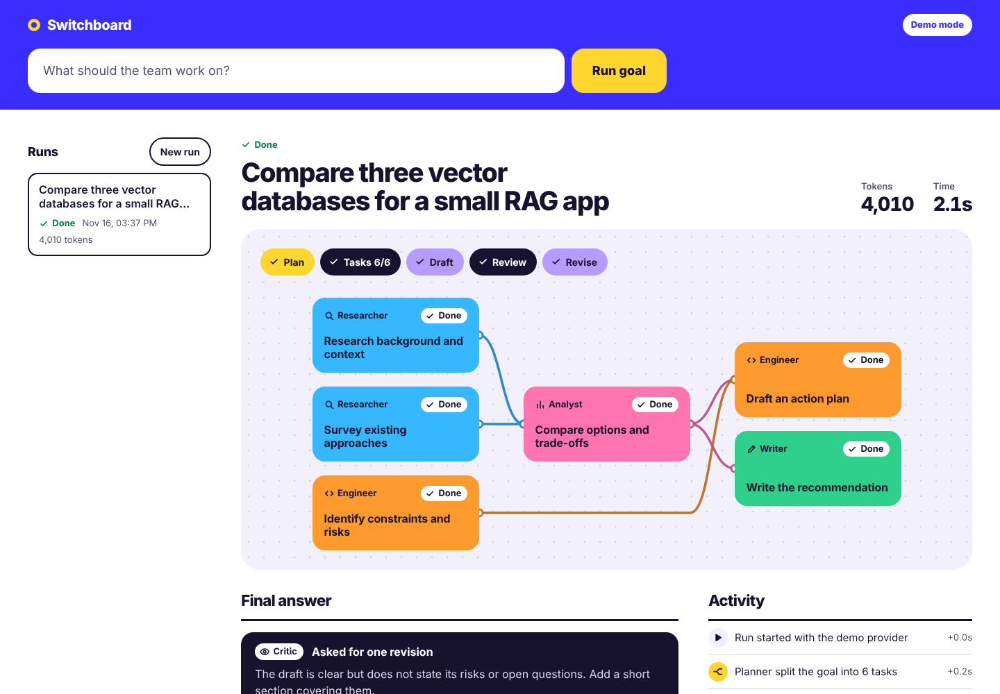
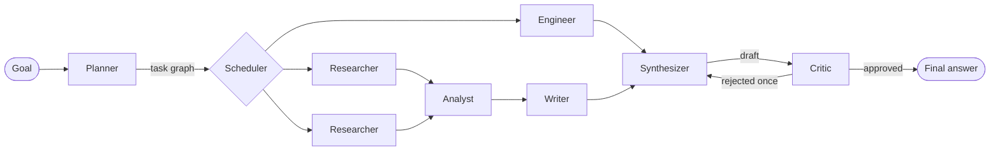

# Switchboard

[](https://github.com/HemanthAce19/switchboard/actions/workflows/ci.yml)

A multi-agent orchestration platform. Give it a goal and a planner agent breaks the goal into a graph of tasks, specialist agents work on those tasks in parallel, and a critic reviews the final answer. Every step is streamed to the browser, so you can watch the team work.



## How a run works



1. **Plan.** The planner returns a list of tasks, each with a role and the tasks it depends on. The plan is validated before anything runs: unique ids, known dependencies, no cycles, and a cap on size.
2. **Schedule.** A task is ready when all of its dependencies have completed. Ready tasks run concurrently, up to a configurable limit, and each one receives the outputs of the tasks it depends on.
3. **Contain failure.** A failing task is retried with backoff. If it still fails, only the tasks downstream of it are skipped. Unrelated branches keep going.
4. **Synthesize and review.** A synthesizer combines the results, a critic reviews the draft, and a rejected draft is revised exactly once.
5. **Record everything.** Each step is written to SQLite as an event and pushed to the browser over Server-Sent Events. The UI is rebuilt from that event log alone, so any past run can be replayed.

## Features

- **Parallel task graph** drawn with a layered layout written for this project. No graph library.
- **Live trace** of every agent step, with per-task output, token counts and timing.
- **Guardrails:** retries with backoff, per-task timeouts, a per-run token budget, cancellation, and recovery of runs interrupted by a restart.
- **Replayable runs.** The event log is the source of truth, and the stream can resume from any event id.
- **Demo mode.** With no API key the back end uses a deterministic offline provider, so the whole app runs and can be tested without a model.

## Tech stack

| Layer | Choice |
|-------|--------|
| Back end | Python, FastAPI, asyncio |
| Storage | SQLite, through the standard library |
| Streaming | Server-Sent Events |
| LLM | OpenAI Responses API with structured outputs, or the built-in demo provider |
| Front end | Next.js (App Router), React, TypeScript in strict mode, plain CSS |
| Tests | pytest for the back end, Vitest for the front end |
| Delivery | Docker Compose, GitHub Actions |

## Quick start

You need Python 3.10 or later and Node.js 20 or later.

```bash
# Terminal 1: back end on http://localhost:8000
cd backend
python -m venv .venv && source .venv/bin/activate
pip install -e ".[dev]"
uvicorn app.main:app --port 8000

# Terminal 2: front end on http://localhost:3000
cd frontend
npm install
npm run dev
```

Open http://localhost:3000 and pick one of the example goals. Or run both with Docker:

```bash
docker compose up --build
```

### Using a real model

The app starts in demo mode. To use OpenAI, set a key before starting the back end:

```bash
export OPENAI_API_KEY=sk-...
export OPENAI_MODEL=...        # optional, overrides the default in backend/app/config.py
```

All settings are environment variables and are listed in `backend/.env.example`.

## API

| Method | Path | Purpose |
|--------|------|---------|
| `GET` | `/api/health` | Status and the active provider |
| `POST` | `/api/runs` | Start a run for a goal |
| `GET` | `/api/runs` | List recent runs |
| `GET` | `/api/runs/{id}` | A run with its tasks and result |
| `POST` | `/api/runs/{id}/cancel` | Cancel a run in progress |
| `GET` | `/api/runs/{id}/events` | Event stream: replays stored events, then follows live |

The full contract, including every event type and JSON shape, is in [SPEC.md](SPEC.md).

## Tests

```bash
cd backend && pytest            # 55 tests
cd frontend && npm test         # 15 tests
```

The back-end tests run offline against a controllable fake provider. They cover plan validation, scheduling order, real concurrency and its limit, retries, timeouts, the token budget, cancellation, the single-revision rule, the event stream (replay, resume and close) and restart recovery. The front-end tests cover the event reducer and the graph layout.

The scheduler tests were checked by breaking the code on purpose. Removing the dependency check, the concurrency limit or the review step each makes the suite fail.

## Design decisions

- **Events are the source of truth.** The UI never asks "what is the state now". It replays events through a pure reducer. That gives live updates, replay of old runs and resume after a dropped connection from one mechanism.
- **Server-Sent Events over WebSockets.** Updates only flow from server to browser, and SSE gives reconnection and resume by event id for free over plain HTTP.
- **One revision, never a loop.** An unbounded critic loop can run forever and burn tokens. One round of feedback captures most of the benefit at a known cost.
- **Failure is contained to a branch.** Skipping only the tasks downstream of a failure means a partial answer is still possible, and the trace shows exactly what was lost.
- **SQLite and in-process tasks.** Enough for a single-node demo and easy to reason about. The limits this creates are listed below.

## Limitations

- Runs execute inside the web process. A restart marks in-flight runs as failed rather than resuming them, and the app cannot scale past one instance without moving runs to a job queue.
- Agents only produce text. They cannot call tools such as web search or code execution yet.
- The OpenAI provider is unit-tested against a fake client. It has not been exercised against the live API in CI.
- There is no authentication, so a public deployment should stay in demo mode.

## Project structure

```
backend/
  app/
    api.py            Routes and the SSE endpoint
    orchestrator.py   Run lifecycle, scheduler, retries, budget, review loop
    planner.py        Plan schema and validation
    providers.py      OpenAI provider and the offline demo provider
    events.py         Event persistence and in-process publish/subscribe
    db.py             SQLite storage
    config.py         Settings from environment variables
  tests/
frontend/
  app/                Page, layout and styles
  components/         Task graph, activity feed, task detail, final answer
  lib/                Types, event reducer, graph layout, API client, SSE hook
  mock/               Contract mock server for front-end development
SPEC.md               The contract both halves were built against
```

## Licence

MIT
